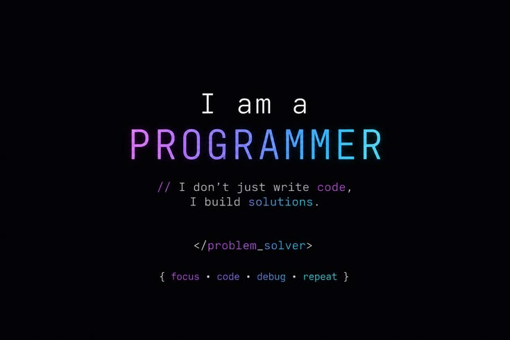

# Hi, I'm Mugisha Leobeni

**Software Engineer · Full-Stack Developer · Aspiring AI Engineer**

*I don't just write code. I engineer solutions to real problems.*

[GitHub](https://github.com/mugishaleobeni) · [LinkedIn](https://www.linkedin.com/in/leobeni-mugisha-9a1540341/)

## About Me

I'm a software developer from Rwanda with an interest in building dependable, useful software and growing into AI engineering. I work across frontend and backend development, enjoy solving complex problems, and believe good engineering means writing maintainable code, testing carefully, and delivering value to people.

## Pylarix

**Pylarix** is my software and technology company, guided by one principle:

> **Beyond Technology. Real Solutions.**

At Pyllarix, the focus is on understanding real-world challenges and turning them into practical, thoughtfully engineered digital solutions.

## Technical Skills

| Area | Technologies |
| :--- | :--- |
| **Frontend** | React, JavaScript, TypeScript, HTML, CSS, Tailwind CSS |
| **Backend** | Python, FastAPI, Flask, Node.js, Express |
| **Databases** | MongoDB, MySQL, MariaDB |
| **Tools & Platforms** | Git, GitHub, Linux, Firebase, REST APIs |
| **AI/ML Learning** | PyTorch, Hugging Face Transformers, model fine-tuning fundamentals |

## Most Used Languages

## Engineering Philosophy

  

I value clear architecture, readable code, security, performance, collaboration, and continuous improvement. I aim to build software that is useful long after the first release.

---

**Learn. Design. Build. Test. Improve.**

*Pylarix — We Create Solutions, Not Technology.*

